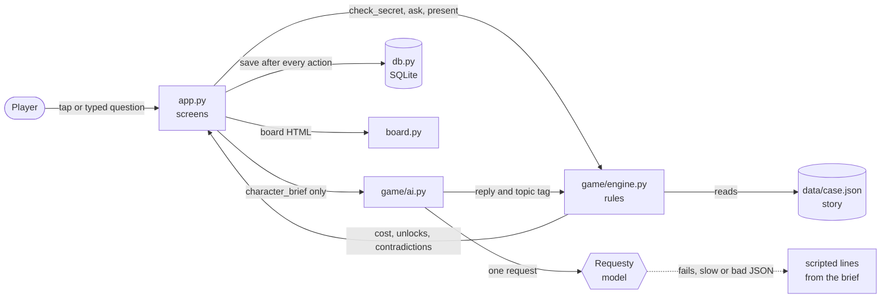

# Death of the Final Exam

A detective game. The night before the Investments exam, the paper leaks in the cohort
group chat. You have until 09:00 to question five suspects, played by AI, and name who did it, how,
where and why. The culprit changes from game to game.

**Play it:** https://carcavelos-paper.streamlit.app

## Team

| Name | Student number |
| --- | --- |
| Duarte Furtado | 80573 |
| Lúcia Pereira | 78729 |
| Martim Pereira | 62329 |
| Salvador Rendeiro | 62548 |

## Run it locally

```bash
python -m pip install -r requirements.txt
streamlit run app.py
```

Python 3.11 or newer (the checks on GitHub use 3.13).

The game runs without an AI key: the suspects then answer with their scripted lines. To let the AI play
them, copy `.env.example` to `.env` and put a [Requesty](https://requesty.ai) key in it. `.env` is
ignored by git.

## Run the tests

```bash
python -m pip install -r requirements-dev.txt
python -m pytest
```

`requirements-dev.txt` adds pytest to the app's own dependencies. The deployed app installs only
`requirements.txt`.

## How to play

On the start screen you choose your detective and a mode. **Normal mode** gives tips; **Hard mode**
is the same case with no tips: no next step, no leads, no hints, no highlighted details, and evidence
crosses nothing off your notebook.

The screen is laid out like a board game. The campus map is the board, the clues are a hand of evidence
cards, and the five suspects sit across the top. Tap anything to open it in the side panel. A new case
starts, in any mode, with a skippable five-step screen walkthrough (map, evidence, suspects, notebook
and Accuse) that can be replayed from **Story and rules**, and the
**Next step** strip above the map always names one useful thing
to do; tap it to go there. The book button shows the briefing again and the speaker button turns the
sound effects on or off.

It is midnight. Every action costs time: searching a place or opening a document costs 30 minutes, and
each question to a suspect (or showing them a card) costs 10. Tap a red **?** card or pin to search it.
Tap a face to interrogate: pick a question, show them a card, or type your own. You can also show an
open card straight from the card itself. Show a suspect the card that breaks their story and you catch
them lying; their portrait turns nervous. Or press them in your own words: a typed question that
quotes a detail from an open card (a time, a card number, a job number) catches the lie the same way
and rattles them more. Tap the lightning in the status bar to see what a caught lie
means and the lies you have caught. Every new card shown raises a suspect's nerves; at full nerves
they crack and let slip where the paper left from. A crack never shows who is guilty: the culprit
cracks exactly like an innocent. Stuck on a locked card? A hint costs 15 minutes,
and the notebook shows your free leads and the night so far. Cross off what it cannot be on the case sheet; the game
crosses off what a wrong accusation has proved. When a card breaks someone's story, your detective notices: the odd detail is
highlighted and a short thought hints at who to show it to. In the story text, a few key words per
sentence (times, places, names) are in bold so a quick read still catches them.

As the clock runs, the night moves on without you: the storm cuts the lights, the Dean calls, students
arrive. These events are story only and change no rules.

When you are ready, press **Accuse** and pick who, how, where and why. Under each answer you can add
an evidence card as proof; on a solved case each right proof raises your rank. You must accuse before
09:00, so you have 540 minutes. At 09:00 you can no longer search or ask; you can only accuse. A wrong
accusation shows which of the four parts are right. After three wrong ones the case goes cold and stays
unsolved: the story never tells you who did it, but the final screen then shows you, the
player, the correct answer.

The status bar also has the notebook button and the moon, which turns on **calm mode**: no
animations, no sounds, and the next step as one plain line. Two round icons sit in the corner (on a
phone, at the end of the page). The
save icon gives you the game's private link (copy it or send it to your own email), so you can close
the tab and carry on later. The restart icon above it starts a new case, after asking first so a
mis-tap never wipes one.

When you solve the case you get your rank out of 100 and a spoiler-free line to share. Solved or cold,
you can download the honour council report.

## How it works

- `data/case.json` holds the story as data: clues, suspects, unlock rules and three variants with
  different culprits.
- `game/engine.py` holds the rules. It decides what is unlocked, what each action costs and whether an
  accusation is right.
- The AI only plays the suspects. It never sees the solution and never decides what unlocks.

All characters, the course and the companies in the game are fictional.

### How one question travels



1. The player taps a card or types a question in `app.py`.
2. A typed question goes through `Engine.check_secret()` first, so a password never reaches the model.
   Then `Engine.press()` checks whether it quotes a detail of an opened card that breaks this
   suspect's story; if so, the lie is caught as if the card were shown. The engine decides, not the model.
3. `game/ai.py` sends only the suspect's brief (including the titles of cards shown to them, their
   lies caught so far and how rattled they are, never a card's text) and the question. The model answers in character and
   picks a topic tag from the list in `case.json`.
4. If the call fails, the suspect answers with scripted lines and the game goes on.
5. `game/engine.py` accepts the tag only if it is on the list, then moves the clock and opens any
   clue it unlocks. The model never decides this.
6. `db.py` saves the game, and `board.py` draws the new board from what the engine returns.


## Where things are

| Part | File | What it does |
| --- | --- | --- |
| Screens | `app.py` | The Streamlit interface: the side panel, the accusation and the reveal. Only shows what the engine returns. |
| Board | `board.py` | Builds the board's HTML (status bar, map, evidence cards, suspects) and turns taps into panel ids. |
| Report | `report.py` | The honour council report the player downloads when the case closes. |
| Pictures and style | `assets/`, `static/` | Evidence pictures, portraits, the map and `style.css`. `static/` holds only the map and portraits, never evidence pictures, because Streamlit serves that folder to anyone. |
| Rules | `game/engine.py` | Clock, unlocks, questions, evidence, contradictions, accusations, badges. |
| Story | `data/case.json`, `game/case.py` | Clues, suspects, claims, the three variants, and the loader that merges a variant. |
| Detective's lines | `data/hunches.json`, `voice.json`, `cracks.json`, `lies.json`, `keyfacts.json`, `ruleouts.json` | The detective's thoughts, what each suspect lets slip when they crack, what a caught lie means, the key fact of each card and what each card crosses off. Tests check them against every variant. |
| AI | `game/ai.py` | Sends one question to the model through Requesty and checks the reply. |
| Storage | `db.py` | Saved games in SQLite. All database code is here. |
| Live reload | `reloading.py` | Rebuilds the engine when Streamlit Cloud pulls new code without restarting. |
| Tests | `tests/` | pytest. They never call the real AI and use a temporary database. |
| Rules for the team and agents | `AGENTS.md` | Branches, reviews, secrets, and the game's design rules. |

## Design decisions and limits

### The engine decides, the AI only acts

The model never decides what is true. `game/ai.py` asks it for a reply and a topic tag from the
list in `case.json`. The engine then decides what that question costs and what it unlocks, and
rejects any topic that is not on the list.

- **Why:** model output can be wrong or in the wrong format. If the AI decided unlocks, a lucky
  or manipulated reply could solve the case.
- **What the model sees:** only `Engine.character_brief()`. That is one suspect's persona, mood,
  cover story and the reveals the player has earned. It never sees the solution, the variant or
  clue text. The leaked PDF has a hidden prompt injection on purpose, and it never reaches the
  model.
- **Bad replies:** a reply that is not valid JSON, or has no `reply` field, is thrown away. The
  suspect then answers with a scripted line.
- **Limit:** the model can still say something off-story in the reply text. It cannot change the
  game, but it can confuse the player for one answer.
- **How it could change:** a second check of the reply text against the suspect's facts in
  `case.json`, or more scripted answers so fewer questions need the model at all.

### What happens when the AI is unavailable

If there is no key, the call fails or times out (15 seconds), or the reply cannot be parsed, the
game keeps working. The suspect answers with scripted lines from `case.json`, and the topic is
picked from keywords in the question.

- **Out of character:** the prompt's rules are also checked in code. A reply is cut to three
  sentences, and a reply in which the suspect admits the leak ("I leaked it", "It was me") is thrown
  away for the scripted answer, so the model can never mislead the player with a false confession.

- **Limit:** the free Requesty plan allows 200 requests per day, shared by the whole account.
- **Per game:** each game makes at most 12 AI calls (`MAX_AI_CALLS`), so about 16 games a day fit in the
  free plan. After that, the suspects use the scripted lines.
- **Why 15 seconds and not less:** a suspect answering in character often takes several seconds;
  a shorter timeout would drop many good answers to the scripted lines.
- **How it could change:** a paid plan with a spending limit, or caching answers to common
  questions. Only `game/ai.py` talks to the model, so another provider means changing that file
  alone.

### Where the data is stored

Saved games are stored in SQLite (`db.py`), in `data/app.db` or the file named by
`DATABASE_PATH`. Each game gets a random 32-character id, which becomes its private resume link
(`?game=<id>`).

- **Access:** there are no accounts. Anyone with the link can resume that game, and nobody can
  list or guess other games. Ids that do not have the right shape are rejected before any query.
- **What is not saved:** the text the player types to the suspects. History records the topic and
  the suspect's scripted answer, never the typed words, so a password typed into the game never
  reaches the database or the model.
- **Limit:** Streamlit Community Cloud has a temporary disk, so saved games are lost when the
  app restarts. That is acceptable for a game that lasts minutes.
- **How it could change:** move `db.py` to a hosted database such as Supabase. Both use SQL, and
  all database code is already in one file.

### Security

- **Secrets:** the Requesty key is read from `REQUESTY_API_KEY` (environment, `.env`, or
  Streamlit secrets) and is never committed. `.env` and `.streamlit/secrets.toml` are in
  `.gitignore`.
- **Logs:** when the AI call fails, the app logs only the error's type and HTTP status. It never
  logs the key, the prompt, the player's question or the model's reply.
- **Error pages:** players see a generic message for an unexpected error, never its type,
  message or traceback (`showErrorDetails = "none"` in `.streamlit/config.toml`). The full
  error goes to the server log.
- **Input:** questions are limited to 300 characters, and empty or blank questions are rejected
  before they cost any time. Typed text is shown as plain text, never as HTML. A model reply
  longer than 600 characters is cut.
- **Password trap:** the Companion asks for your password. Anything that looks like a password
  or an API key is stopped by `Engine.check_secret()` before it reaches the model, and the chat
  shows a note instead of the typed text.
- **Resume links:** a link that is malformed, unknown or points to a damaged save starts a new
  case. Every action reloads the saved game first, so a second tab with an old copy cannot undo
  progress, or a cold case, made in another tab.
- **Hidden content:** locked clue text never reaches the browser. The interface reads clues only
  through `Engine.clue_list()` and `Engine.read_clue()`.
- **Dependencies:** three for the app (`requirements.txt`) and pytest for the tests only
  (`requirements-dev.txt`), each pinned to an exact version and checked for
  known vulnerabilities by `pip-audit` on every pull request.
- **Limits:** the password trap is a pattern check, so it can miss an unusual password or stop a
  harmless word that looks like one (for example a long word mixing letters and digits). Anyone
  who has a game's link can open that game.
- **How it could change:** accounts with a login would tie each game to a player instead of to a
  link, and the trap could ask the player to confirm before hiding a message.

### What the tests cover, and what they do not

**Covered:**
- the rules: costs, unlocks, locked clues, wrong and repeated actions, the three-strike limit,
  and running out of time
- each variant's story consistency, and claims and contradictions
- the AI layer, with fake model replies: bad JSON, code fences, failures, the call limit, and
  the password trap
- that briefs never contain the solution
- saving and resuming, including malformed ids, old saves, damaged saves and two open tabs
- invalid input: blank, too long or HTML questions, replies of the wrong shape, AI timeouts
  and rejected keys (`tests/test_invalid_input.py`)
- the main screens, through Streamlit's `AppTest`
- simulated players: thousands of random actions, right and wrong, after which the rules must
  still hold (`tests/test_random_players.py`)

**Not covered:**
- the real model's replies, which change from run to run
- how the pages look in a real browser
- the taps inside the board's HTML component (the tap parser itself is tested)
- the deployed host (sleep, restarts)

These are checked by hand on the live app before a demo.

### Known limits and next steps

- **One player per game:** there are no accounts and no shared games.
- **Temporary saves:** saved games are lost when the host restarts. See *Where the data is
  stored* above.
- **Hand-written story:** the three variants are hand-written in `case.json`. A new variant
  means new data and new consistency tests, not new code.
- **AI quota:** the 200 requests per day are shared by everyone playing the deployed app.
